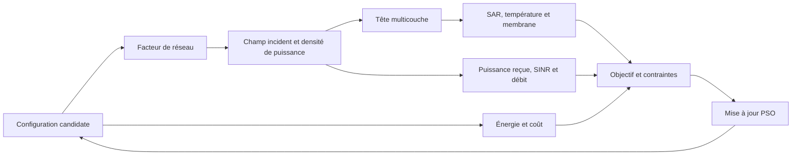

# RF Lab — Optimisation d’un réseau d’antennes BTS par PSO

Mini-projet de radiofréquences consacré au compromis entre **exposition électromagnétique, qualité de service, énergie et coût** d’une station de base.

**Université de Tunis El Manar · École Nationale d’Ingénieurs de Tunis (ENIT)**

Département des Technologies de l’Information et de la Communication · Année universitaire 2026–2027

**Réalisé par : Louay Njah et Louay Hammoudi**

**Sous la supervision de : M. Taoufik Aguili**

## Objectif du projet

Augmenter la puissance d’une BTS peut améliorer le lien radio, mais aussi accroître la consommation et l’exposition calculée. Le nombre d’antennes, leurs positions, leurs amplitudes et leurs phases modifient également ce compromis.

Le projet formule ce problème comme une optimisation multicritère sous contraintes. L’algorithme **PSO — Particle Swarm Optimization** recherche une configuration candidate, puis la chaîne de calcul évalue son champ électrique, ses indicateurs biophysiques, son débit, son énergie et son coût.

> Ce dépôt contient un modèle pédagogique. La faisabilité retournée par le programme correspond aux seuils configurés ; elle ne constitue pas une certification de conformité ni une validation physiologique.

## Contenu du dépôt

| Fichier | Rôle |
| --- | --- |
| [main (2).py](<main (2).py>) | Modèle scientifique, évaluation des configurations, PSO, études fréquentielles et graphiques optionnels. |
| [dashboard.py](dashboard.py) | Interface Streamlit pour lancer l’optimisation et explorer les résultats. |
| [README.md](README.md) | Présentation du projet, installation, méthodologie et lecture des résultats. |

Le tableau de bord charge directement `main (2).py`. Conserver ce nom et placer les deux fichiers dans le même dossier.

## Installation et lancement

Environnement utilisé pour la vérification : **Python 3.11**.

```bash
git clone https://github.com/LouayHM3/rf-lab-pso.git
cd rf-lab-pso
python -m venv .venv
```

Activer l’environnement sous Windows PowerShell :

```powershell
.\.venv\Scripts\Activate.ps1
```

Sous Linux ou macOS :

```bash
source .venv/bin/activate
```

Installer les dépendances et démarrer l’interface :

```bash
python -m pip install "numpy>=2.0" "streamlit>=1.40"
python -m streamlit run dashboard.py
```

Ouvrir l’adresse indiquée par Streamlit, généralement **http://localhost:8501**.

Pour exécuter uniquement le modèle en console :

```bash
python "main (2).py" --no-plot
```

Pour générer également `resultats_rf.png`, installer Matplotlib puis lancer le script sans `--no-plot` :

```bash
python -m pip install matplotlib
python "main (2).py"
```

## Chaîne de modélisation



### Configuration des antennes

Chaque particule stocke **19 coordonnées** : puissance totale, fréquence, nombre d’éléments, amplitudes, phases, positions, polarisation, orientation, hauteur et distance horizontale BTS–utilisateur. La représentation conserve quatre emplacements possibles ; seuls les `N` éléments actifs sont utilisés.

| Paramètre | Bornes de la version actuelle |
| --- | --- |
| Puissance RF totale de la BTS | 1 à 40 W |
| Fréquence | 3,5 à 15 GHz |
| Nombre d’éléments actifs | 2 à 4 |
| Amplitudes relatives | 0,1 à 1 |
| Positions sur l’axe du réseau | 0 à 2 m |
| Hauteur de la BTS | 10 à 40 m |
| Distance horizontale BTS–utilisateur | 5 à 500 m |
| Espacement minimal entre éléments | Une demi-longueur d’onde |

Les amplitudes sont normalisées en puissance : leur somme de carrés normalisée vaut 1. La puissance `Pt_W` désigne ainsi la puissance **totale** de la BTS. Le même champ incident alimente les branches radio et exposition.

### Propagation dans les tissus et thermique

La tête est représentée par cinq couches : **peau, graisse, os, liquide céphalorachidien et cerveau**. Le programme calcule les transmissions aux interfaces, l’atténuation dans les couches et les profils de champ et de SAR. Les propriétés diélectriques dépendent de la fréquence par interpolation log-log de tables approximatives.

La température est calculée avec une équation de Pennes discrétisée en volumes finis et intégrée par un schéma implicite. Le modèle prend en compte la conduction, la perfusion et les conditions aux limites. La configuration par défaut utilise un pas spatial de **0,5 mm**, un pas temporel de **5 s** et une durée de **360 s**.

Le champ de propagation est exprimé en RMS ; le calcul du SAR utilise une amplitude crête. Le potentiel membranaire repose sur une réponse RC harmonique simplifiée.

### Lien radio, énergie et coût

La puissance reçue découle de la densité de puissance incidente, de l’aire effective du récepteur et du facteur de polarisation. Le SINR combine cette puissance avec le bruit et les interférences configurés. Le débit théorique est calculé par `Rb = B × log2(1 + SINR)`, avec une bande de **20 MHz** par défaut.

L’énergie dépend de la puissance RF, du rendement d’amplification et de la durée choisie. Le coût est paramétrique : par défaut, il est proportionnel au nombre d’éléments ; `full_cost` permet d’ajouter les coûts fixes prévus dans le code.

## Fonction objectif et optimisation

La formulation issue du rapport combine six contributions normalisées :

```text
J(X) = W1 × SAR/SAR0
     + W2 × ΔT/ΔT0
     + W3 × |ΔVm|/ΔVm0
     + W4 × Econs/E0
     − W5 × Rb/Rb0
     + W6 × Caut/C0
```

Le débit est soustrait pour favoriser une meilleure qualité de service. Les références de normalisation rendent les grandeurs comparables ; les poids permettent d’ajuster le compromis.

Les variables sont réparées avant évaluation : projection dans les bornes, arrondi de `N`, tri et espacement des positions. Les contraintes fonctionnelles ajoutent une pénalité quadratique :

```text
fitness(X) = J(X) + 100000 × somme(violation_normalisée²)
```

Le code vérifie l’exposition, la température, le potentiel membranaire, le champ interne, le SINR, le débit, la puissance et l’énergie. La contrainte d’exposition sélectionne le SAR ou la densité de puissance absorbée selon la fréquence et les seuils configurés. **Dans l’implémentation actuelle, le terme d’exposition de l’objectif reste le SAR**, même lorsque la contrainte utilise la densité de puissance absorbée.

PSO est retenu pour évaluer une chaîne couplée sans calculer de gradient, avec des variables continues et un nombre d’éléments discret. Il ne garantit pas l’optimum global.

| Réglage PSO par défaut | Valeur |
| --- | --- |
| Graine aléatoire | 21 |
| Particules | 30 |
| Itérations | 80 |
| Inertie | Décroissance de 0,85 à 0,40 |
| Coefficients cognitif et social | 1,7 et 1,7 |

Les hypothèses physiques, bornes, seuils, poids et références sont regroupés dans `CONFIG`, au début de `main (2).py`. Les curseurs du tableau de bord modifient le nombre de particules et d’itérations ; le bouton de lancement relance le calcul.

## Tableau de bord

L’interface propose quatre vues :

- **Vue d’ensemble** : indicateurs, convergence, configuration retenue et contraintes.
- **Graphiques scientifiques** : profils de champ et de SAR, évolution thermique et balayage fréquentiel.
- **Lien radio** : champ RMS, puissance reçue, polarisation, facteur de réseau, gain et densité incidente.
- **Interprétation & conclusion** : lecture synthétique du résultat et rappel des hypothèses.

## Rapport initial et version du dépôt

Ce README reprend la problématique et la méthodologie du rapport *Optimisation d’une configuration d’antennes de station de base par PSO — étude numérique à fréquence fixée : 15 GHz*. Le code du dépôt est une évolution multicouche de cette première étude.

| Aspect | Étude du rapport | Version actuelle du dépôt |
| --- | --- | --- |
| Fréquence | 15 GHz fixés | Optimisée entre 3,5 et 15 GHz |
| Tissu | Milieu homogène | Cinq couches |
| Température | Approximation adiabatique | Équation de Pennes |
| Puissance | Puissance par élément | Puissance totale BTS |
| Budget PSO | 24 particules, 50 itérations | 30 particules, 80 itérations |
| Présentation des résultats | Sortie console et figures | Console et interface Streamlit |

### Résultats de référence

La colonne « rapport » provient de son exécution enregistrée. La colonne « modèle actuel » provient d’une réexécution locale avec la graine 21 et les paramètres par défaut du dépôt.

| Indicateur | Rapport initial | Modèle actuel |
| --- | --- | --- |
| Fréquence retenue | 15 GHz | 3,5 GHz |
| Éléments actifs | 3 | 2 |
| Puissance RF totale | 0,30 W | ≈ 9,31 W |
| Débit théorique | ≈ 12,299 Mbit/s | ≈ 500,536 Mbit/s |
| SINR | ≈ 1,289 dB | ≈ 75,34 dB |
| Énergie sur une heure | 0,45 Wh | ≈ 26,59 Wh |
| Objectif final | 0,64433266 | −4,32217776 |

**Ces scores ne mesurent pas une amélioration directement comparable** : les modèles, les bornes, les paramètres radio et les normalisations diffèrent. Un objectif négatif est possible puisque la contribution du débit est soustraite.

Le rapport complet et les supports de présentation ne sont pas inclus dans ce dépôt.

## Limites et points de lecture

- **Modèles physiques** : espace libre, réseau sur un axe, propriétés tissulaires approximatives et transmission en cascade sans résolution des réflexions multiples. Une validation indépendante reste nécessaire.
- **SAR** : la version actuelle extrait un maximum local sur le maillage, sans moyennage massique validé. Le comparer au seuil configuré ne suffit pas à établir une conformité.
- **Thermique et membrane** : les propriétés, le maillage, les conditions aux limites et le couplage électrique doivent être confrontés aux données du cours et à des références validées.
- **Balayage fréquentiel** : `evaluate()` appelle `repair()`, qui borne la fréquence. Avec les bornes par défaut, les demandes à 0,9 et 2,45 GHz sont évaluées à 3,5 GHz, même si le tableau affiche la fréquence demandée.
- **Contraintes affichées** : la colonne « Marge » du tableau de bord contient une **violation normalisée**. Zéro signifie absence de violation détectée, pas distance nulle au seuil.
- **Robustesse** : une graine reproductible ne caractérise pas la dispersion. Plusieurs graines, une analyse de sensibilité des poids et des bornes, ainsi qu’une comparaison à une méthode de référence sont des prolongements utiles.

## Références reprises du rapport

- Kennedy, J. et Eberhart, R. (1995). *Particle Swarm Optimization*. [DOI : 10.1109/ICNN.1995.488968](https://doi.org/10.1109/ICNN.1995.488968).
- Friis, H. T. (1946). *A Note on a Simple Transmission Formula*. [DOI : 10.1109/JRPROC.1946.234568](https://doi.org/10.1109/JRPROC.1946.234568).
- Shannon, C. E. (1948). *A Mathematical Theory of Communication*. [DOI : 10.1002/j.1538-7305.1948.tb01338.x](https://doi.org/10.1002/j.1538-7305.1948.tb01338.x).
- Balanis, C. A. (2016). *Antenna Theory: Analysis and Design*, 4e édition, Wiley.
- ENIT, Département TIC. *Mini-projet RF : optimisation d’une configuration d’antennes de BTS*, sujet et annexes fournis.
